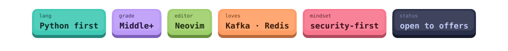

<!-- Картинки между метками ENGINE пересобирает движок (python -m engine build). -->
<!-- Текст вне меток можно править как угодно. -->

<!-- ENGINE:DIV_PROFILE:START -->

  

<!-- ENGINE:DIV_PROFILE:END -->

<!-- ENGINE:BADGES:START -->

  

<!-- ENGINE:BADGES:END -->

<!-- ENGINE:NVIM:START -->

  

<!-- ENGINE:NVIM:END -->

<!-- ENGINE:DIV_PROJECTS:START -->

  

<!-- ENGINE:DIV_PROJECTS:END -->

<!-- ENGINE:ALGORITHMS:START -->

  

<!-- ENGINE:ALGORITHMS:END -->

<!-- ENGINE:AURA:START -->

  

<!-- ENGINE:AURA:END -->
